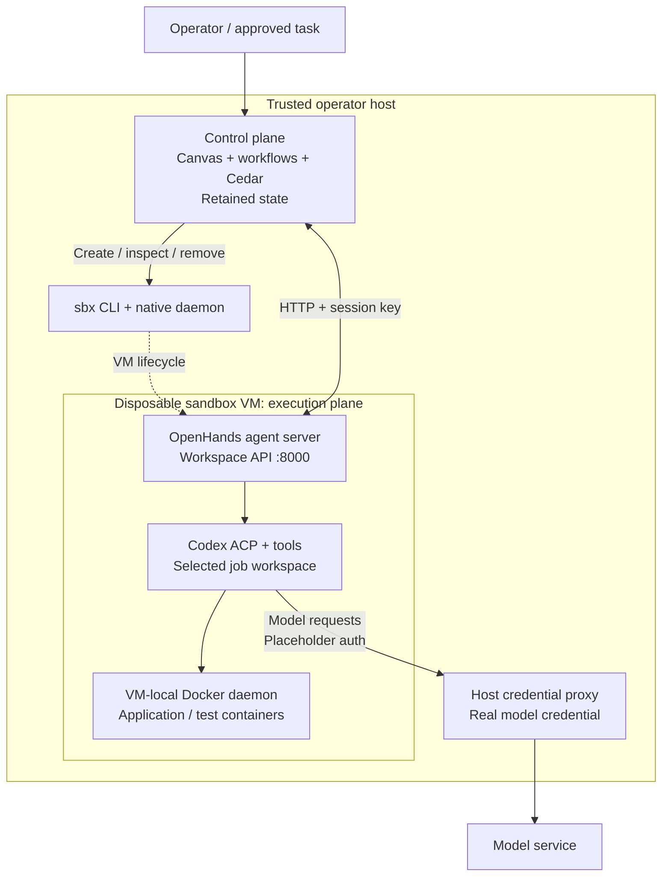
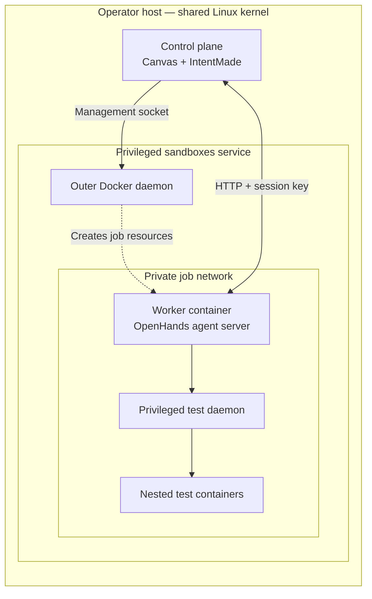
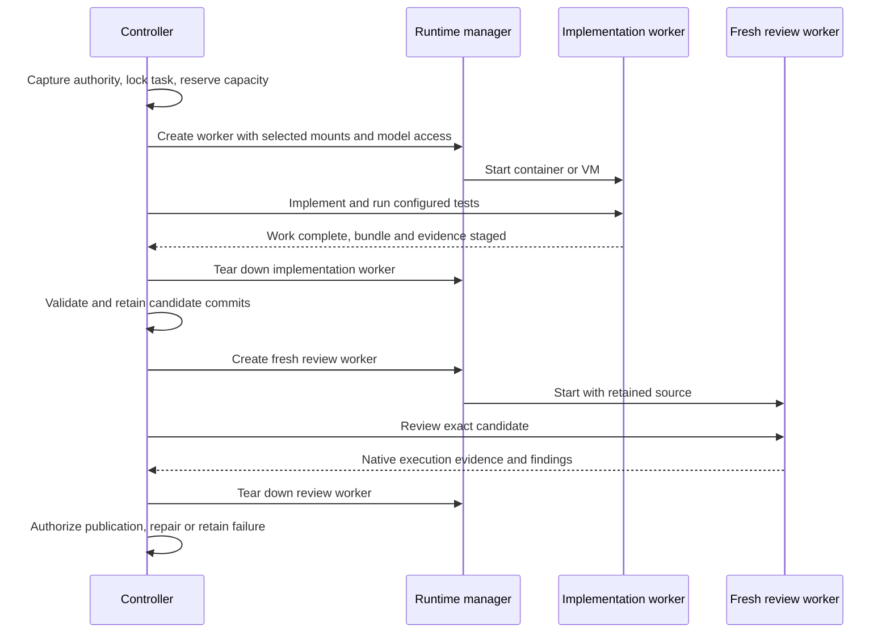

# IntentMade architecture

IntentMade turns an approved request into implementation, tests, independent
review and optional GitHub publication. It is a **single-operator factory** with
disposable workers, not a hosted multi-tenant service. The controller owns
authority and retained state; workers execute repository-controlled code.

This map describes source at `69c583e` (reviewed 2026-10-27). Runtime installation
and uploaded automations must match that source to have the same behavior.
[The specification](spec.md) owns requirements; [the threat model](threat-model.md)
owns assets, invariants and attack scenarios. Deployment commands belong in
[operations](operations.md) and [Docker Sandboxes](docker-sandboxes.md).

## Planes and responsibilities

| Component | Runs where | Owns |
| --- | --- | --- |
| Canvas and native OpenHands automation | Trusted controller container | Operator conversations, profiles, secrets, schedules and native run tracking |
| IntentMade Python workflows | Controller | Intake, task identity, capacity, stage sequencing, evidence validation, repair and publication |
| Cedar bridge and bundled policy | Short-lived controller subprocess | Current-fact authorization decisions; no task database or scheduler |
| Runtime adapter | Controller, calling Docker or `sbx` | Worker creation, session key, mounts, observed identity and cleanup |
| OpenHands agent server | Disposable worker container or VM | Workspace API, conversations and tool execution |
| Codex ACP or native OpenHands agent | Worker | Implementation/review behavior under controller-selected stage permissions |
| Per-worker test Docker daemon | Job network or sandbox VM | Nested application/test containers; no host management socket |
| Host Docker / native sandbox daemon | Trusted operator host | Infrastructure lifecycle and runtime isolation |

The control/execution distinction is logical: both planes normally occupy one
Linux host. The agent server is a control endpoint **inside** the execution plane.
A worker can host multiple conversations; a conversation is not a VM. A grouped
implementation can place several repositories in one worker.

Finite operator recipes are a separate privileged path: they execute trusted
commands in the native automation environment rather than entering the ordinary
worker pipeline. Optional OpenGauss/Lean tooling augments writable Codex
implementation sessions without changing review or publication gates; see
[finite recipes](finite-automations.md) and [agent modes](agents.md).

Entry points: [factoryctl](../scripts/factoryctl), [configuration and submission](../scripts/configure.py),
[build_group](../workflows/run.py#L253), [scheduler](../workflows/monitor.py),
[native dispatch](../workflows/native_queue.py), [authorization](authorization.md).

## Docker Sandboxes backend

`factoryctl` renders a backend-specific Compose model. It removes the default
`sandboxes` service and gives **the trusted controller** the native daemon socket,
CLI, selected host authentication directories and read-only Kit/profile paths.
Those host credential directories are not worker mounts. See
[sandbox_compose.render](../scripts/sandbox_compose.py#L20).

For each worker context, [docker_sandboxes.worker](../workflows/docker_sandboxes.py#L94)
creates a local VM with `--pull never`, checks its proxy placeholder, starts the
agent server as `agent`, discovers the published port and connects a
`RemoteWorkspace`. The API uses a random session key over HTTP on the configured
private host address (loopback for a host-run controller). It is not an
internet-facing TLS runner protocol. Cleanup removes the VM.

The Kit extends `codex`. Docker owns real worker OAuth and refresh; the VM gets
`proxy-managed`, and IntentMade does not upload Canvas's `CODEX_AUTH_JSON`.
The host-global sandbox login is a shared authority, not a tenant credential
namespace. Canvas's coordinator login remains separate. The proxy in the diagram
represents the external runtime's credential boundary, not an IntentMade service.

The [v2 Kit](../docker/sandbox-kit/spec.yaml) sets CPU, memory, Docker storage and
allowed destinations. Its privilege is inside the VM. Docker tests use the
VM-local daemon, with `docker` resolving to loopback. The adapter targets the
documented `sbx` version; it does not provide cloud VM placement. Effective network
policy and host compatibility still need the [native probes](docker-sandboxes.md).

## Default DockerWorkspace backend

There are three Docker roles: the host engine runs Compose; the `sandboxes`
service manages workers; each worker has a separate daemon for tests. Workers
receive access to their test daemon, not the outer management socket. The outer
daemon's firewall restricts private-network and cross-job connections. All these
containers still share the host kernel, including the privileged daemons.

[compose.yaml](../compose.yaml), [sandbox.docker_worker](../workflows/sandbox.py#L195),
[job daemon configuration](../workflows/sandbox.yaml) and
[outer firewall](../runtime/sandbox-daemon) implement this layout.

| Choice | DockerWorkspace | Docker Sandboxes |
| --- | --- | --- |
| Worker isolation | Containers sharing host kernel | Local VM per worker context |
| Agent harness | Codex ACP or native OpenHands | Codex ACP; native OpenHands rejected |
| Worker model authority | Real selected Codex credential or native LLM profile | Host proxy; placeholder in VM |
| Worker resource policy | Deployment limits, Docker update and job Compose | Native Kit; container limits do not configure the VM |
| Network policy | Outer daemon firewall | Kit plus global native Docker policy |
| Agent server transport | HTTP via outer daemon host | HTTP via configured private host address |

Neither option makes Canvas a tenant authorization boundary. Read
[threat-model.md](threat-model.md) before changing credentials, mounts or ingress.

## Task lifecycle and recovery

This shows the main path; optional browser QA adds its own worker stage.

1. **Admit:** CLI/Canvas submission or scheduler captures authorized scope and
   repository identity. Native automation starts a separate run. Cedar evaluates
   applicable current-fact gates; Python validates evidence and performs actions.
2. **Reserve:** task locks exclude duplicate work for the same repository/task.
   Deployment and per-repository slots bound active tasks. Independent tasks in
   one repository can overlap; the default capacity is two.
3. **Prepare:** trusted bare task stores retain branch/base identity. The controller
   stages fresh sources, frozen declared inputs and selected test profiles.
4. **Implement and test:** a disposable worker creates worktrees, runs the agent
   and controller-selected checks, then exports candidate commits as a bundle.
5. **Retain:** after worker teardown, bounded parent Git processes validate/import
   the expected ref. Worker Git configuration and hooks are not imported.
6. **Validate independently:** browser QA, when selected, and review use fresh
   workers. Codex review uses native role/thread evidence; native OpenHands uses
   a separate restricted reviewer conversation. The controller derives the verdict.
7. **Repair or publish:** failures enter bounded repair or request input. The
   final Cedar validation gate and current source/approval rechecks precede
   publication. Group PRs publish sequentially, so partial publication is possible.

An explicit retry after incomplete review may reuse a controller validation
checkpoint only when request, candidate, inputs, policy, environment and retained
evidence still match. It still runs fresh independent review. Failed/new checks
cannot fall back to an older passing checkpoint. See
[validation_checkpoint](../workflows/validation_checkpoint.py#L219) and
[repair context](repair-context.md#retry-an-incomplete-review).

Capacity and exclusion use filesystem/kernel locks, not distributed leases.
Native queue receipts, issue attempts and continuation records persist outside
workers. Lost runs become visible interruptions; a host crash can leave runtime
resources needing reconciliation. Task completion, validation success and
publication success are distinct outcomes.

Sources: [execution](../workflows/execution.py#L67), [implementation](../workflows/run.py#L453),
[review](../workflows/run.py#L758), [pipeline](../workflows/run.py#L896),
[run health](../workflows/run_health.py#L130), [lifecycle](../workflows/lifecycle.py).

## State and authority

| State | Controller location | Lifetime / worker visibility |
| --- | --- | --- |
| Canvas profiles, secrets, conversations, native runs | `/home/openhands/.openhands` state volume | Persistent; not mounted into workers |
| Operator policy | `/opt/factory/config` | Read-only controller mount; not a worker-selected policy |
| Catalog and requests | `/projects/repos`, `/projects/requests` | Persistent; catalog read-only, selected sources copied into jobs |
| Task stores | `DATA/tasks/PROJECT/TASK.git` | Persistent; fresh source copies sent to workers |
| Job workspace | `DATA/job-*` | Worker-writable; retained if export/recovery fails |
| Inputs and profiles | `/factory-inputs`, `/factory-tests/NAME` | Selected read-only worker mounts |
| Results, logs, patches, authorization receipts | `/projects/artifacts` | Persistent controller records; selected evidence copies may enter later workers |
| Locks and scheduling receipts | Under `DATA` | Persistent coordination metadata outside each worker's job mount |

`DATA` is `FACTORY_DATA`, defaulting to `/workspaces`. Default Compose maps it to
`FACTORY_DATA_DIR/workspaces`. The sbx renderer sets it to that **absolute host
path**, also mounted unchanged into Canvas, because native VM mounts use host
paths. `/projects/artifacts` remains a separate mapping to
`FACTORY_DATA_DIR/artifacts`. These are host directories, not independent tenant
storage domains. See [common.py](../workflows/common.py#L16),
[input artifacts](input-artifacts.md) and [mount selection](../workflows/sandbox.py#L58).

## Future multi-tenant and customer-owned execution

These are design directions from the architecture/threat-model discussions,
**not capabilities of this source tree**. It has no tenant gateway, GitHub OAuth
membership service, Fly deployment, remote-runner protocol or Kubernetes backend.

| Direction | Proposed boundary | Work still required |
| --- | --- | --- |
| Minimal Fly demonstrator with GitHub login | Separate complete factory, credentials, storage and network per tenant; narrow shared gateway | Tenant/resource authorization, authenticated fixed adapter routing, durable deduplication, lifecycle fencing and actual platform qualification |
| Customer-owned execution | Hosted intake/dispatch; trusted tenant runner owns local orchestration and sandbox credentials | Outbound authenticated task protocol, installation identity, expiring/fenced assignments, cancellation/reconciliation and artifact export policy |
| Kubernetes deployment | Infrastructure placement underneath the application | Decide which services/runners it hosts; preserve VM isolation, tenant boundaries and capacity accounting |

The Fly demo design selected DockerWorkspace inside each tenant VM; that is
different from running nested Docker Sandboxes VMs. Two apps alone do not establish
the intended network/storage separation. Keep publication and scheduling disabled
for that demonstration and qualify the full execution stack first.

For customer execution, move the local workflow orchestration with the runner:
the existing adapter assumes local daemon access, shared paths and reachable
worker HTTP endpoints. Keep the cloud interface at task dispatch/results rather
than exposing those worker APIs. Customer-owned compute does not prevent source
leaving through model requests or uploads, and a customer-controlled runner can
fabricate its own results. A signed result identifies its sender, not truthful
execution.

Kubernetes would manage infrastructure health and placement; IntentMade would
still own approval, tenant ownership and validation. The existing `sbx` adapter
creates VMs locally, so wrapping it in a pod does not make each VM schedulable
across a cluster. Proposed tenant invariants and verification obligations are in
[the threat model](threat-model.md#future-tenant-and-runner-contract).

## Where to change the system

| Feature | Start here | Preserve |
| --- | --- | --- |
| New intake or continuation | `scripts/configure.py`, `monitor.py`, `submissions.py`, `continuations.py` | Current authority, immutable task identity, deduplication |
| New runtime | `sandbox.py`, `docker_sandboxes.py`, `scripts/sandbox_compose.py` | Credential custody, narrow mounts, identity, teardown |
| New workflow gate | `run.py`, `authorization.py`, `runtime/cedar/` | Evidence validation before authorization and side effects |
| New review/tool capability | `agent.py`, `harness.py`, `factory_reader.py`, `review.py` | Independent evidence and stage-enforced permissions |
| New persistence/recovery path | `execution.py`, `lifecycle.py`, `validation_checkpoint.py` | Source binding, uncertainty, no blind replay |

Use [CONTRIBUTING.md](../CONTRIBUTING.md) and follow the affected requirement into
its code and assertions. Ordinary docs should link to those contracts instead
of creating a second set of promises.
