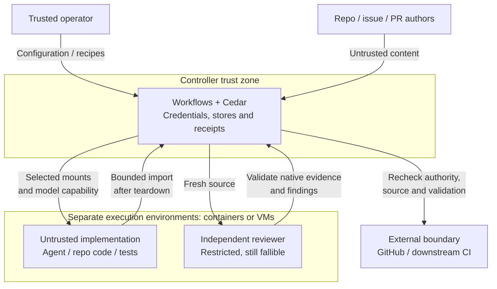
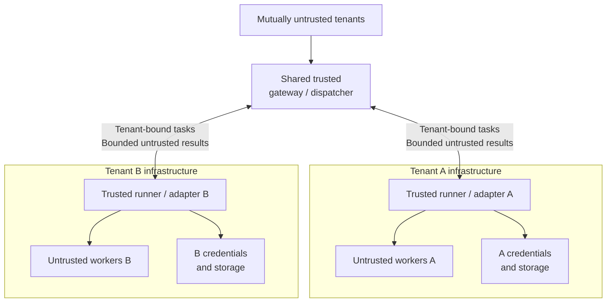

# IntentMade threat model

This model covers the single-operator factory at `69c583e`, reviewed 2026-10-27.
It starts with assets and falsifiable invariants, then identifies the actors,
boundaries and controls that protect them. Scenarios are review priorities, not
confirmed vulnerabilities. Source review, including an independent architecture
pass, does not establish live kernel, provider or deployment isolation.

The earlier multi-tenancy model described a proposed Fly/GitHub demonstration.
Its tenant invariants remain future obligations below; they are not guarantees
of this checkout. [Architecture](architecture.md) owns component layout and
lifecycle; [SECURITY.md](../SECURITY.md) owns operator assumptions and disclosure;
[spec.md](spec.md) owns the current requirements and assertion links.

## Overview

The trusted controller admits work, prepares sources, launches disposable workers,
retains commits, evaluates independent review and publishes authorized results.
Repository content, tools, dependencies and model output are untrusted. Worker
isolation protects the controller; it does not turn one controller into a service
for mutually distrustful customers.

The independent reviewer is a separate execution environment, not a second
trusted controller. Review judgment remains fallible. GitHub-triggered CI and
model services are external boundaries, even when the factory's own checks pass.

| Component | Security responsibility and source |
| --- | --- |
| Intake and continuation | Capture/recheck specification, author authority and PR identity: [approval.py:74](../workflows/approval.py#L74), [continuations.py:101](../workflows/continuations.py#L101) |
| Controller authorization | Validate current facts, response identity and durable receipt: [authorization.py:40](../workflows/authorization.py#L40), [policy.cedar](../runtime/cedar/policy.cedar) |
| Worker runtime | Select credentials, mounts, resources and provenance: [sandbox.py:72](../workflows/sandbox.py#L72), [docker_sandboxes.py:94](../workflows/docker_sandboxes.py#L94) |
| Transfer and retention | No-follow job writes, bounded Git import, exact source/evidence binding: [job_files.py:33](../workflows/job_files.py#L33), [transfer.py:57](../workflows/transfer.py#L57), [validation_checkpoint.py:219](../workflows/validation_checkpoint.py#L219) |
| Review and publication | Native execution evidence, coverage and current GitHub state: [review.py:366](../workflows/review.py#L366), [review_publication.py:81](../workflows/review_publication.py#L81) |

### Effective resources

`DATA` means `FACTORY_DATA`, default `/workspaces`; the sbx deployment instead
sets it to the absolute host workspace path. Paths below identify authority and
recipients, not credential contents.

| Deployment or workflow | Resource or capability | Configuration and precedence | Effective location | Recipients | Enforcing control | Evidence or unknowns |
| --- | --- | --- | --- | --- | --- | --- |
| Both controllers | Canvas session/encryption keys and native state | Compose secrets/state mounts; entrypoint reads keys | `/run/secrets/{canvas-key,encryption-key}`, `/home/openhands/.openhands` | Controller | Loopback UI binding; native API authentication/store encryption; no worker state mount | [compose.yaml:9](../compose.yaml#L9), [entrypoint:10](../runtime/entrypoint#L10); native service implementation is external |
| DockerWorkspace control | Outer Docker management | Compose `DOCKER_HOST` and socket group | `/run/factory-docker/docker.sock` | Controller/outer daemon | Absent from worker mounts | [compose.yaml:17](../compose.yaml#L17), [sandbox.py:58](../workflows/sandbox.py#L58) |
| sbx control | VM management and host login | Host daemon status and `XDG_CONFIG_HOME` mapped by renderer | `/run/sbx/sandboxd.sock`; host `com.docker.sandboxes`, `sbx`, `sandboxes` directories | Trusted controller/native runtime | Selected mounts; not forwarded to workers | [sandbox_compose.py:58](../scripts/sandbox_compose.py#L58); read-only socket-directory mount still permits daemon API calls |
| DockerWorkspace Codex | Real model credential | Selected Codex profile; `OH_SECRET_KEY` or mounted encryption key | Controller `CODEX_AUTH_JSON` → worker secret API/native binding | Controller and selected worker | Versioned refresh cannot overwrite newer login/logout | [sandbox.py:95](../workflows/sandbox.py#L95), [sandbox.py:37](../workflows/sandbox.py#L37) |
| DockerWorkspace native agent | API-backed LLM authority | Saved agent → selected LLM profile | Resolved native conversation configuration | Selected worker | Only selected credential; no Codex login delivery | [harness.py:28](../workflows/harness.py#L28), [sandbox.py:88](../workflows/sandbox.py#L88) |
| sbx Codex | Proxy model access | Kit extends `codex`; native host OAuth binding | Placeholder in `CODEX_HOME/auth.json`; real OAuth stays host-side | Worker can use proxy; host retains token custody | Placeholder checked before startup; no Canvas-secret fallback | [docker_sandboxes.py:147](../workflows/docker_sandboxes.py#L147); refresh/proxy internals external |
| Worker APIs | Workspace control | Fresh session key; runtime-selected port | Docker: `http://sandboxes:PORT`; sbx: `http://HOST:PORT` → VM `8000` | Controller and selected server | Session authentication; private transport assumptions | [sandbox.py:102](../workflows/sandbox.py#L102), [docker_sandboxes.py:201](../workflows/docker_sandboxes.py#L201); no adapter TLS |
| Task/source custody | Trusted stores versus writable work | `DATA` mapping, selected mounts | `DATA/tasks/PROJECT/TASK.git`; `DATA/job-*`; inputs at `DATA/input-artifacts/DIGEST` | Stores: controller; job: worker/test daemon; inputs: read-only | Task locks, fresh clones, bounded import, input hashes | [run.py:67](../workflows/run.py#L67), [input_artifacts.py:134](../workflows/input_artifacts.py#L134), [sandbox_compose.py:75](../scripts/sandbox_compose.py#L75) |
| DockerWorkspace limits | Worker/test resources | Deployment limits → Docker update; job Compose | Worker container and private test daemon | Selected job | Limits applied before work; outer firewall | [sandbox.py:220](../workflows/sandbox.py#L220), [sandbox.yaml](../workflows/sandbox.yaml) |
| sbx limits | VM resources/network | Operator Kit plus global native policy | VM CPU/memory/storage and destination policy | Selected VM | Native runtime; does not inherit outer firewall or DockerWorkspace limits | [Kit](../docker/sandbox-kit/spec.yaml), [network limitations](docker-sandboxes.md#network-policy); no established whole-VM PID cap |
| Results | Evidence and audit records | Separate Compose artifact bind; controller writers | `/projects/artifacts` → host artifact directory | Controller/operator; selected evidence copied to workers | Private authorization receipts; bounded export and narrow redaction | [authorization.py:40](../workflows/authorization.py#L40); logs/exports are not automatically sanitized |
| GitHub publication | Repository write/review authority | Stored GitHub token loaded by parent | Native secret store → parent GitHub client | Controller, not workers | Current source/approval rechecks before push/post | [common.py:200](../workflows/common.py#L200), [run.py:162](../workflows/run.py#L162) |

## Threat model, trust boundaries and assumptions

### Assets and invariants

These summaries reference existing requirements; they do not declare new OFT
artifacts or replace the specification's acceptance criteria.

| Asset | Invariant | Current contract |
| --- | --- | --- |
| Controller credentials and capabilities | Worker receives only the selected backend's model authority, not controller/GitHub management authority | [worker-credentials](spec.md#use-the-selected-backend-credential-boundary), [deployment-authority](spec.md#keep-deployment-authority-separate) |
| Approved task and repository identity | Later edits, queued jobs and replies cannot silently change the authorized source/task | [approval-snapshot](spec.md#bind-issue-approval-to-content), [task-identity](spec.md#bind-retained-tasks-to-their-repository-and-base-branch), [thread-follow-up](spec.md#continue-approved-pr-scope-in-the-same-conversation) |
| Retained source and files | Worker metadata cannot execute parent Git helpers or redirect parent writes; failed retention preserves recoverable work | [git-transfer](spec.md#import-commits-without-worker-git-configuration), [safe-controller-writes](spec.md#write-job-files-without-following-worker-links) |
| Validation and review evidence | Success corresponds to the selected candidate and required independent evidence; prose cannot grant authority | [publication-gate](spec.md#publish-only-validated-changes-as-drafts), [review evidence](reviews.md), [checkpoint reuse](repair-context.md#retry-an-incomplete-review) |
| Execution capacity and run state | Same task cannot execute concurrently through normal factory admission; active tasks and expensive imports are bounded | [task concurrency](configuration.md#task-concurrency), [resource limits](configuration.md#resource-limits) |
| Audit and recovery records | Attribution/source binding comes from controller observations; retained uncertainty cannot become a fabricated success | [authorization receipts](authorization.md#decision-and-evidence), [provenance](execution-provenance.md), [operations](operations.md) |
| Private source, prompts, logs and exports | Sharing is a separate operator action; redaction or a passing check does not declassify evidence | [portable workflow](portable-workflow.md#continue-elsewhere) |

Protecting **token bytes** and protecting **usable model access** are different
objectives. DockerWorkspace intentionally delivers a real selected credential.
The sbx proxy hides real token bytes but still grants model use and spending
authority while available. Neither is a provider budget mechanism.

### Actors and boundary enforcement

An external author may control issue/PR text, repository instructions, test code
or dependencies. An executing worker can control its processes, files and Git
metadata and use its granted model access. Neither starts with Canvas access,
deployment control, parent GitHub credentials or trusted receipts. A labeler,
maintainer or allowed bot has exactly the authority explicitly delegated by intake
and feedback policy; legitimate use of that authority is not an escalation.

| Boundary | Required enforcement and limitation |
| --- | --- |
| Operator/device → controller | Authenticated ingress; Canvas access grants factory control. Tenant identity and within-controller tenant isolation are absent. |
| Task content → controller action | Capture/recheck authority and source; Cedar decides from controller-validated facts. It is not authentication and cannot protect against a compromised controller fabricating facts. |
| Controller → worker | Narrow mounts, per-worker API key, selected model capability, enforced runtime limits. Docker's privileged daemons share the host kernel; sbx relies on native VM enforcement. |
| Worker → controller | Tear down before bundle import; safe file operations and bounded Git; never import mutable worker configuration. Files and reports remain untrusted content. |
| Implementation → review | Fresh sources/new worker. Codex uses read-only sandbox, no command network/escalation and native project trust; native OpenHands uses only bounded FactoryReader operations. |
| Reviewer → publication | Validate actual reviewer identity/completion, structured findings and complete file coverage; report editing cannot remove findings or downgrade blockers. Fresh authority/source/CI checks still apply. |
| Controller → external service | Model/provider and GitHub scopes constrain external authority. A pushed branch can trigger target CI outside this factory's sandbox. |
| Operator recipe/update → controller | Finite recipes run in the trusted automation environment; image builds/patches and configuration are privileged operator inputs, not ordinary worker tasks. |

Review controls: [agent.py:237](../workflows/agent.py#L237),
[FactoryReader](../workflows/factory_reader.py#L44),
[Codex permission patch](../runtime/patch_review_policy.py),
[native plugin isolation](../runtime/patch_native_harness.py),
[report consolidation](../workflows/review_report.py#L75).
Codex project directories are not automatically trusted; operator home/system
configuration remains trusted. Explicitly trusting a repository changes that
boundary. The custom seccomp exception supports Codex namespaces; it is not a VM
or an extra `CAP_SYS_ADMIN` grant to the default agent container. See
[the seccomp contract](../runtime/codex-seccomp.md).

Assumptions: trusted host, operator configuration, authorized devices, runtime
images and infrastructure administrators. Known limitations include HTTP worker
transport, sbx hostname/DNS/global-policy behavior, shared-kernel Docker execution,
no hard disk/provider-spend quota, and no guarantee of model correctness. Restarts
release kernel locks but do not prove all old execution has stopped. Native
runtime probes, effective ingress/network configuration and crash cleanup remain
deployment responsibilities. Digests bind bytes, not the honesty of their producer.

### Future tenant and runner contract

The earlier two-tenant design aimed to contain even a compromised tenant
controller. Its gateway and infrastructure operator remain trusted across tenants.
The following keeps the earlier `INV`/`PROP` identifiers in the **proposal** domain;
none is a claim of implemented tenant protection or executed property testing.

The diagram is a logical protocol boundary: a customer-owned runner initiates
an outbound connection; the original Fly demo used gateway-to-adapter calls.
There must be no cross-tenant storage, credential or management capability.

| Proposed invariant IDs | Contract to implement | Proposed checks |
| --- | --- | --- |
| INV-01, INV-02 | Current session membership and immutable resource ownership govern every operation; changing B's private state does not alter A's data or side effects | PROP-01 endpoint/identity matrix; PROP-02 metamorphic isolation, including caches |
| INV-03, INV-04 | Trusted registry selects destination/authority; hostile adapter output cannot choose URLs, paths, cookies, ownership or executable commands | PROP-05 malicious redirects, headers, encodings, slow/oversized responses |
| INV-05 | A has no mount, credential, management interface or permitted route granting B's authority | PROP-10 deployed probes from both worker and compromised-controller positions |
| INV-06 | Downloads return only bounded stable regular-file snapshots belonging to the authorized job | PROP-06 real symlink/hardlink/special-file and rename-race fixtures |
| INV-07, INV-08 | At most one active demo job per tenant; a submission key binds one payload/project/registration and logical job; uncertain execution retains capacity | PROP-04 real database/process races and crashes around admission, launch and acknowledgement |
| INV-09, INV-13 | Revocation, replacement and restore cannot revive old sessions or change ownership; stale assignments are fenced | PROP-03 login/revoke/re-enable sequences; PROP-08 restore and retired-identity replay |
| INV-10 | Demo publication/scheduling stay disabled; output cannot invent validation or expand policy | PROP-07 instrument attempted provider writes and false PASS/policy output |
| INV-11 | Per-tenant and shared input/output, queue, stream, execution and retained-storage budgets are enforced outside workers | PROP-11 saturate A while B completes a bounded reference task |
| INV-12 | Audit identity comes from authenticated registry state; admission is durable before dispatch; secrets are not logged by default | PROP-09 database/audit faults and forged actor fields |

All tests need successful authorized cases as well as rejections. Observe actual
dispatches, returned bytes, live workers and provider writes; checking an
authorization helper alone does not establish isolation. Add mutation checks for
removed ownership predicates, ignored generations, redirects and premature
capacity release. These property suites do not exist in current main.

Open decisions before that feature: server-authenticated adapter transport and
bounded response schema; crash-safe launch/reconciliation; revocation ordering;
read versus write audit-failure behavior; aggregate budgets; per-tenant credential
rotation; safe artifact capture; restore fencing. Existing CLI `--no-publish` is
operator intent, not an immutable tenant permission: a narrow adapter must enforce
the demo policy, omit factory write credentials, and qualify public-repo access
without assuming the existing CLI is credential-free.

Customer-owned execution additionally needs installation-bound runner identity,
expiring assignments with fencing generations, cancellation acknowledgement and
an explicit data-export policy. Customer control of compute also means customer
control of reported results: authenticated reports are not proof of execution.
Kubernetes placement alone does not supply these properties. See
[architecture directions](architecture.md#future-multi-tenant-and-customer-owned-execution).

## Attack surface, mitigations and attacker stories

These are hypotheses to test, ordered by potential authority gained. Priority is
review order, not a finding severity. Existing controls narrow each scenario;
their presence is not a claim that every implementation is defect-free.

| Priority | Scenario and capability gain | Prerequisites | Impact | Existing controls | Mitigation / verification | Evidence |
| --- | --- | --- | --- | --- | --- | --- |
| P0 | Public content gains Canvas or host authority | Exposed controller or exploitable native integration | Controller secrets and arbitrary management actions | Loopback UI; worker separation; trusted configuration | Restrict ingress; qualify native runtime; never expose Canvas as tenant API | [compose.yaml:9](../compose.yaml#L9), [SECURITY](../SECURITY.md#single-operator-factory) |
| P0 | Worker escapes through daemon/network/mounts | Runtime/kernel flaw or misconfiguration | Other jobs, host data or controller authority | Separate test daemon; Docker firewall or native VM policy | Run selected backend's real network/credential probes; inspect effective mounts | [sandbox.py:207](../workflows/sandbox.py#L207), [sandbox-daemon](../runtime/sandbox-daemon), [VM limits](docker-sandboxes.md#network-policy) |
| P0 | Worker-controlled files/Git metadata execute in parent or overwrite trusted state | Malicious job output reaching import/write path | Controller execution, secret disclosure or corrupted evidence | Teardown, regular/no-follow bounded bundle, expected ref, fsck/no-force; safe writes | Preserve real filesystem/ref/amplification regressions | [transfer.py:57](../workflows/transfer.py#L57), [test_transfer](../tests/test_transfer.py), [test_job_files](../tests/test_job_files.py) |
| P1 | Changed issue/PR/reply reuses stale authority | Eligible input followed by edit/replay | Unauthorized work or GitHub write | Captured identity, current rechecks, Cedar and consumed-answer receipts | Exercise edit order, lost acknowledgement and revision changes | [approval.py](../workflows/approval.py), [test_continuations](../tests/test_continuations.py), [test_manual_intake](../tests/test_manual_intake.py) |
| P1 | Agent invents PASS or poisons reused validation | Forged/missing/stale review or checkpoint data | Unvalidated source published | Native reviewer evidence, coverage, digest binding, fresh review and final Cedar gate | Test source/policy/environment mutations and receipt failures | [test_specialist_review](../tests/test_specialist_review.py), [test_validation_checkpoint](../tests/test_validation_checkpoint.py), [test_authorization](../tests/test_authorization.py) |
| P1 | Worker obtains broader credentials or restores stale login | Incorrect propagation or refresh race | Parent/provider authority beyond selected access | Backend-specific delivery; versioned refresh; no sbx token fallback | Native credential probes; canary secret inventory; never enable passthrough | [test_worker_credentials_backend](../tests/test_worker_credentials_backend.py), [sandbox.py:37](../workflows/sandbox.py#L37) |
| P1 | Hostile workload or crash exhausts shared resources / duplicates work | Admitted work, interrupted process or retained output growth | Factory outage or extra spending | Capacity locks, import bounds, timeouts, durable dispatch records | Crash/restart tests and operator cleanup; explicit retention budgets | [execution.py](../workflows/execution.py), [resource_limits.py](../workflows/resource_limits.py), [test_run_health](../tests/test_run_health.py) |
| P1 | Authorized push causes privileged downstream execution | Target CI runs PR code with secrets/privilege | CI secrets or runner compromise | Factory validation precedes push; no control over target CI | Constrain CI permissions and deployment approvals at target repository | [run.py:210](../workflows/run.py#L210), [SECURITY](../SECURITY.md#software-building-capabilities) |
| P2 | Private diagnostics/handoff leak source or secrets | Operator shares generated evidence | Confidentiality loss | Bounded regular-file export and narrow redaction | Inspect/redact a separate release copy; hashes are not sanitization | [export_handoff.py](../scripts/export_handoff.py), [sharing procedure](portable-workflow.md#continue-elsewhere) |
| P2 | Operator recipe or runtime update is mistaken for untrusted worker input | Authority to submit finite recipes or change runtime | Full controller actions by already trusted actor | Explicit operator trust; pinned dependencies and fail-on-drift patches | Keep these entry points outside any future tenant API | [finite.py:51](../workflows/finite.py#L51), [runtime patches](runtime-patches.md) |

Current verification combines example/matrix unittests and selected real Git,
Cedar, filesystem and subprocess checks. It does not establish formal
noninterference, honest models or live Fly isolation. Runtime/credential/network
probes in [tests/README.md](../tests/README.md) must run on the selected backend;
scripted API responses cannot replace them.

## Severity calibration

| Severity | Example if established | Prerequisite / counterexample |
| --- | --- | --- |
| Critical | Unauthenticated input reaches controller execution and broad stored credentials | Requires a demonstrated reachable chain; prompt injection by itself does not establish this impact |
| High | Worker gains controller GitHub authority or reads unrelated private task data | Reading its intentionally supplied DockerWorkspace model token is not this escalation |
| Medium | Bounded authenticated abuse materially disrupts other work or bypasses a limited approval condition | Assess actual duration, affected resources and permission gained; raise severity for secret theft or durable control |
| Low | Limited non-sensitive metadata or audit-display confusion | A status difference without useful private data/authority is not automatically a significant boundary failure |

Prior operator/host compromise is outside this model; gaining that control from
untrusted inputs is inside it. A compromised worker/controller can lie about its
own work, and already-exported data or in-flight provider requests cannot be
recalled. Cross-tenant severity only applies after the proposed tenant boundary
exists. Record missing evidence separately from potential impact.
